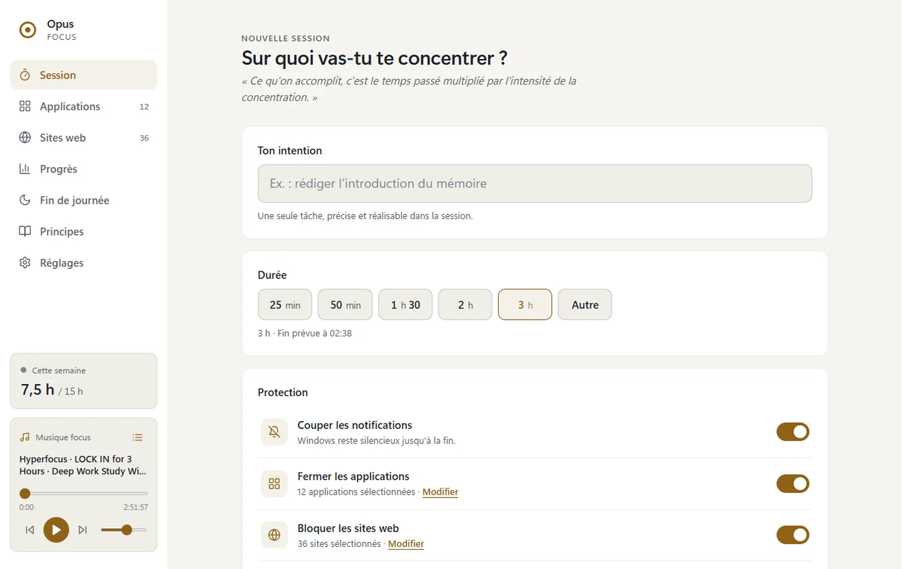
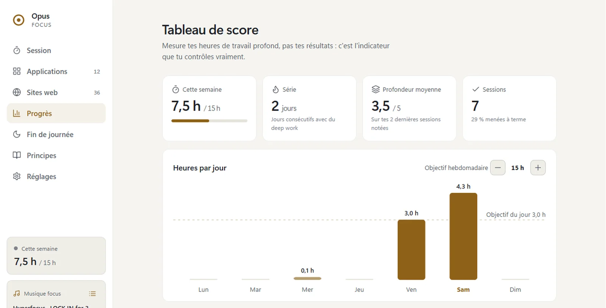
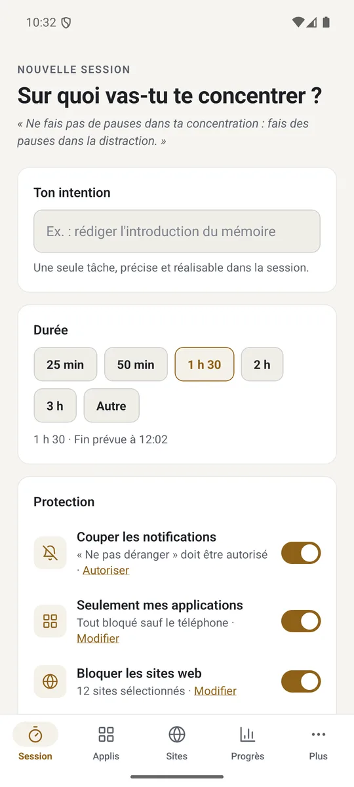
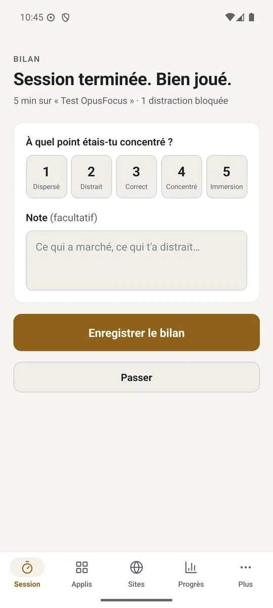

<div align="center">


# OpusFocus

**Une seule chose à la fois.**

Bloqueur de distractions inspiré du livre *Deep Work* de Cal Newport, pour Windows et Android.<br>
Gratuit, sans compte, aucune donnée envoyée.


[**⬇ Télécharger pour Windows**](https://github.com/antoinebonpro/OpusFocus/releases/latest/download/OpusFocus-Setup.exe) ·
[Android (APK)](https://github.com/antoinebonpro/OpusFocus/releases/latest/download/OpusFocus.apk) ·
[Site](https://antoinebonpro.github.io/OpusFocus/)



</div>

---

## Sommaire

- [Le principe](#le-principe)
- [Installer](#installer)
- [Une session, pas à pas](#une-session-pas-à-pas)
- [Au quotidien sur Windows](#au-quotidien-sur-windows)
- [Les pages](#les-pages)
- [Réglages par défaut](#réglages-par-défaut)
- [Comment ça marche](#comment-ça-marche)
- [Questions et dépannage](#questions-et-dépannage)
- [Désinstaller](#désinstaller)
- [Le projet](#le-projet) : structure, construction, tests
- [Tes données](#tes-données) · [Sécurité](#sécurité) · [Limites connues](#limites-connues)

## Le principe

> « Le travail profond est la capacité de se concentrer sans distraction sur une tâche cognitivement exigeante. » — Cal Newport

Tu écris ce sur quoi tu vas travailler, tu choisis une durée, et OpusFocus fait le vide autour de toi jusqu'à la fin :

- 🔕 **les notifications** se taisent ;
- 🚫 **les applications** qui te distraient se ferment dès qu'elles s'ouvrent ;
- 🌐 **les sites** cochés ne s'ouvrent plus, dans aucun navigateur ;
- 🔒 **le mode engagement** t'empêche d'abandonner sur un coup de tête : pour arrêter, il faut taper une phrase que tu as choisie.

À la fin, OpusFocus te prévient et te propose un bilan rapide (profondeur de 1 à 5, plus une note). Tes heures, tes séries et ta progression s'affichent dans *Progrès*.

## Installer

### Windows 10 et 11

1. Télécharge et lance **`OpusFocus-Setup.exe`**.
2. Windows demande **une seule fois** les droits administrateur, pour installer le **service de blocage des sites** (voir [plus bas](#le-service-de-blocage-des-sites-windows)). Ensuite, plus aucune demande.
3. OpusFocus s'ouvre. Pour l'avoir toujours sous la main, fais un clic droit sur son icône dans la barre des tâches, puis **Épingler à la barre des tâches**.

> [!NOTE]
> L'installateur n'est pas signé, donc Windows SmartScreen peut afficher « Windows a protégé votre ordinateur ». Clique sur *Informations complémentaires*, puis sur *Exécuter quand même*.

Une ancienne version (installée dans ton profil) est remplacée automatiquement, et tes données sont conservées.

**Version portable** : `OpusFocus.exe`, à lancer sans installation. Elle n'a pas de service, donc le blocage des sites demande le mode administrateur à chaque session.

### Android 7.0 et plus

Copie `OpusFocus.apk` sur le téléphone, ouvre-le et autorise l'installation. Au premier lancement, l'application te demande trois autorisations, à donner une seule fois :

| Autorisation | Sert à |
|---|---|
| Accessibilité | savoir quelle application est au premier plan, pour bloquer les applications |
| « Ne pas déranger » | couper les notifications |
| VPN local | bloquer les sites |

## Une session, pas à pas

1. **L'intention.** Écris en une phrase ce que tu vas faire (« Rédiger le chapitre 3 »). C'est la règle n° 1 du livre : savoir ce qu'on fait avant de commencer.
2. **La durée.** De 5 minutes à 8 heures, 90 minutes par défaut, ce qui correspond à un bon bloc de travail profond.
3. **Les protections.** Notifications, applications, sites : coche ce que tu veux couper.
4. **Le mode engagement** (facultatif). Une fois la session lancée, tu peux **ajouter** des blocages mais pas en **retirer**. Pour abandonner, il faut taper ta phrase d'abandon en entier (par défaut : *j'abandonne ma session de deep work*).
5. **Commencer.** Un minuteur s'affiche, avec le compteur des distractions bloquées. Tu peux fermer la fenêtre, la session continue.
6. **La fin.** OpusFocus rouvre la fenêtre, lève les blocages et te demande un bilan : profondeur de 1 à 5 et une note libre.

Si l'ordinateur ou le téléphone redémarre pendant une session, elle reprend là où elle en était. Si l'application plante, les sites se débloquent quand même à l'heure prévue.

## Au quotidien sur Windows

| | |
|---|---|
| **Toujours là** | Une icône OpusFocus reste près de l'horloge. Fermer la fenêtre ne quitte pas l'app, et un clic sur l'icône la rouvre. Pour l'arrêter : clic droit, puis *Quitter* (impossible pendant une session). |
| **Épinglée** | L'icône épinglée dans la barre des tâches ouvre OpusFocus, ou ramène la fenêtre si elle est déjà ouverte. |
| **Au démarrage** | OpusFocus se lance discrètement à l'ouverture de session, près de l'horloge. Réglable dans *Réglages*. |
| **Sans droits admin** | Le blocage des sites passe par le service installé, donc tu n'as plus rien à accepter. |

## Les pages

1. **Session** : intention, durée, protections, puis *Commencer*. Pendant la session, un minuteur et le nombre de distractions bloquées.
2. **Applications** : les applications installées, avec leur icône et leur catégorie (réseaux, jeux, vidéo, navigateurs). Les distractions détectées sont proposées en premier. Sur Android, le mode « Seulement mes apps » bloque tout sauf les applications cochées (téléphone, clavier et réglages restent accessibles).
3. **Sites web** : un catalogue à cocher, plus tes propres sites. Bloquer `youtube.com` bloque aussi `www.youtube.com` et `m.youtube.com`.
4. **Progrès** : heures de la semaine et objectif, série de jours, profondeur moyenne, taux de sessions menées à terme, graphique par jour et historique.
5. **Fin de journée** : la checklist du rituel de fin de journée, jusqu'au « Shutdown complete ».
6. **Principes** : les quatre règles du livre.
7. **Musique focus** : tes pistes audio. Elles reprennent là où tu t'étais arrêté et peuvent démarrer et s'arrêter avec la session. Sur PC, dépose tes fichiers (`mp3`, `m4a`, `aac`…) dans `Musique\OpusFocus` ; sur Android, ajoute-les depuis l'application.
8. **Réglages** : démarrage, musique, phrase d'abandon, objectif de la semaine, état du blocage des sites.

<div align="center">



</div>

## Réglages par défaut

Tout se change dans l'application.

| Réglage | Valeur de départ |
|---|---|
| Durée d'une session | 90 min (de 5 min à 8 h) |
| Objectif de la semaine | 15 h (de 1 à 80 h) |
| Applications bloquées | Discord, Slack, WhatsApp, Telegram, Messenger, Steam, Epic Games, Spotify |
| Sites bloqués | Facebook, Instagram, X / Twitter, TikTok, YouTube, Reddit, Netflix, Twitch, LinkedIn, Snapchat, Pinterest |
| Phrase d'abandon | *j'abandonne ma session de deep work* (10 à 150 caractères) |
| Lancement au démarrage | activé |
| Musique avec la session | désactivée |
| Rituel de fin de journée | derniers messages, tâches en suspens notées, agenda relu, blocs de demain planifiés |

## Comment ça marche

| Protection | Windows | Android |
|---|---|---|
| Notifications | Notifications Windows coupées via le registre, puis restaurées | Mode « Ne pas déranger » (prioritaires seulement), puis retour au réglage d'avant |
| Applications | Processus cochés fermés dès qu'ils apparaissent (vérification toutes les 1,5 s) | Service d'accessibilité : l'application bloquée est remplacée par l'écran « Reste concentré » |
| Sites | Domaines (avec `www.` et `m.`) redirigés vers `0.0.0.0` dans le fichier `hosts` par le service de blocage, puis cache DNS vidé | VPN local qui ne transporte que le DNS : domaines et sous-domaines bloqués, le reste passe normalement |
| Fin à l'heure | Le moteur reste actif près de l'horloge et rouvre la fenêtre pour le bilan | Service au premier plan (compte à rebours en notification), notification de fin, réveil de secours |
| Mode engagement | Phrase d'abandon à taper ; on peut ajouter des blocages, pas en retirer | Identique |
| Démarrage | Clé `Run` de Windows (`--startup`) | Ouverture au démarrage du téléphone ; une session en cours reprend après un redémarrage |

### L'architecture Windows

```
 Fenêtre Edge en mode app ──HTTP + jeton──► opusfocus.py / OpusFocus.exe (sans droits)
 (interface ui/)                 127.0.0.1    ├─ minuteur, sessions, statistiques
                                              ├─ ferme les applications bloquées
                                              ├─ coupe les notifications (registre)
                                              ├─ icône près de l'horloge
                                              └─ écrit la demande de sites ──► service SYSTEM ──► hosts
```

Il n'y a pas de framework : l'interface est en HTML, CSS et JavaScript sans dépendance, et le moteur est un seul fichier Python (bibliothèque standard + `ctypes`). L'exe est construit avec PyInstaller.

### Le service de blocage des sites (Windows)

Windows protège le fichier `hosts`, qui sert à bloquer les sites : il faut être administrateur pour y écrire. Plutôt que de lancer toute l'application en administrateur, l'installateur met en place un tout petit service :

```
OpusFocus (sans droits)                          Service (SYSTEM, tâche planifiée au démarrage)
  │  écrit la liste des sites + l'heure de fin   │
  └──► C:\ProgramData\OpusFocus\sites.json ─────►│  relit chaque seconde
                                                 └──► écrit le bloc OpusFocus dans hosts
```

- Le service ne fait **qu'une chose** : aligner le bloc OpusFocus du fichier `hosts` sur la demande. Il revalide chaque domaine, refuse les fichiers trop gros, les liens et les demandes de plus de 9 h, et n'écrit que des lignes `0.0.0.0 domaine`. Un programme malveillant qui modifierait la demande ne pourrait que bloquer ou débloquer des sites, jamais rediriger vers une autre adresse.
- Il **refuse toujours** de bloquer les domaines vitaux du système : Windows Update, Microsoft, les autorités de certificats, les principaux antivirus.
- Une demande illisible ou piégée est notée dans le journal, et le service continue de tourner.
- Chaque demande porte son **heure de fin** : si l'application plante, les sites se débloquent quand même à l'heure prévue.
- Il est installé dans `Program Files`, où seul un administrateur peut modifier l'exécutable.
- On le voit dans le *Planificateur de tâches*, sous `OpusFocus\Blocage des sites`.

Sans le service (par exemple en lançant `opusfocus.py` directement), le bouton *Activer le mode administrateur* relance OpusFocus avec les droits, le temps d'une session.

### Épinglage dans la barre des tâches

La fenêtre est une fenêtre Edge (ou Chrome, Brave) en mode application. OpusFocus lui donne sa propre identité dans la barre des tâches (`AppUserModelID` et commande de relance) : une fois épinglée, l'icône relance `OpusFocus.exe` et non le navigateur.

## Questions et dépannage

<details>
<summary><b>Un site bloqué s'ouvre quand même.</b></summary>

- Le navigateur utilise peut-être le **DNS sécurisé** (DNS over HTTPS), qui contourne le fichier `hosts`. Désactive-le : dans Edge, *Paramètres > Confidentialité > Sécurité > Utiliser un DNS sécurisé* ; dans Chrome, *Paramètres > Confidentialité et sécurité > Sécurité*.
- Un onglet déjà ouvert peut rester affiché : recharge-le.
- Vérifie dans *Réglages* que le blocage des sites est disponible (« Service de blocage installé »).
</details>

<details>
<summary><b>Les Réglages disent que le blocage des sites n'est pas disponible.</b></summary>

Le service n'est pas lancé. Ouvre le *Planificateur de tâches*, puis `OpusFocus\Blocage des sites`, et clique sur *Exécuter*. S'il n'existe pas, réinstalle OpusFocus avec `OpusFocus-Setup.exe`.
</details>

<details>
<summary><b>Je ne trouve plus la fenêtre.</b></summary>

Clique sur l'icône OpusFocus près de l'horloge (elle peut être cachée sous la flèche ^), ou relance OpusFocus depuis le menu Démarrer : la fenêtre existante revient au premier plan.
</details>

<details>
<summary><b>Je veux arrêter une session en mode engagement.</b></summary>

C'est voulu : il faut taper la phrase d'abandon en entier. Elle se change dans *Réglages*, mais seulement en dehors d'une session.
</details>

<details>
<summary><b>Une application bloquée a perdu mon travail.</b></summary>

Les applications bloquées sont fermées de force. Ne coche que des applications de distraction, pas un éditeur où tu as du travail en cours.
</details>

<details>
<summary><b>Quelque chose ne marche pas.</b></summary>

Les erreurs sont notées dans `%APPDATA%\OpusFocus\erreurs.log`. Joins ce fichier en ouvrant une [issue](https://github.com/antoinebonpro/OpusFocus/issues).
</details>

<details>
<summary><b>Android : l'accessibilité est grisée.</b></summary>

Sur Android 13 et plus, une application installée hors du Play Store doit d'abord être autorisée : ouvre la fiche de l'application, menu ⋮, puis *Autoriser les paramètres restreints*.
</details>

## Désinstaller

- **Windows** : *Paramètres > Applications > OpusFocus > Désinstaller*. Le service, le dossier `C:\ProgramData\OpusFocus`, tout bloc resté dans `hosts` et le lancement au démarrage sont retirés. Tes statistiques restent dans `%APPDATA%\OpusFocus` : supprime ce dossier pour tout effacer.
- **Android** : désinstalle l'application comme n'importe quelle autre, et ses données partent avec elle.

## Le projet

```
opusfocus.py          moteur Windows : blocages, serveur local, icône, service de blocage des sites
ui/                   interface (HTML, CSS, JS sans dépendance), servie sur 127.0.0.1
scan_apps.ps1         liste des applications du menu Démarrer et du Microsoft Store
installer/            installateur Inno Setup (droits admin une fois, service, raccourcis)
build.ps1             construit l'exe et l'installateur
tests/                tests du moteur Windows
mobile/               application Android (Expo / React Native)
  src/                    écrans et logique de l'app
  modules/focus-blocker   code natif Kotlin : blocage, VPN DNS, session, démarrage
docs/                 site de présentation (GitHub Pages)
```

### Lancer depuis les sources

```powershell
pythonw opusfocus.py            # ou double-clic sur « Lancer OpusFocus.bat »
```

Il faut Python 3.10+ (aucun paquet à installer) et Edge, Chrome ou Brave.

### Construire

```powershell
powershell -ExecutionPolicy Bypass -File build.ps1                            # dist\OpusFocus.exe + dist\OpusFocus-Setup.exe
powershell -ExecutionPolicy Bypass -File mobile\scripts\build-apk.ps1 -Test   # dist\OpusFocus.apk (+ tests natifs)
```

L'installateur demande Inno Setup 6 (`winget install JRSoftware.InnoSetup --source winget --scope user`) et l'exe demande PyInstaller. L'APK demande Android Studio (JDK et SDK).

### Tester

```powershell
python -m unittest discover -s tests -v          # Windows : 86 tests
cd mobile; npm test; npm run typecheck; npm run lint
```

Les tests Windows travaillent dans un dossier temporaire : ils ne touchent ni tes données, ni le vrai fichier `hosts`, ni la vraie clé de démarrage.

## Tes données

- **Windows** : `%APPDATA%\OpusFocus\` (`config.json`, `sessions.json`, `apps.json`, `state.json`, `erreurs.log`). Les données des versions « Deep Work Focus » sont reprises automatiquement au premier lancement.
- **Android** : stockage interne de l'application.

Rien ne quitte ton appareil : pas de compte, pas de statistiques envoyées, pas de publicité.

## Sécurité

- **Windows** : l'interface n'écoute que sur `127.0.0.1`. Chaque appel à l'API exige un jeton aléatoire, l'en-tête `Host` est vérifié (protection contre le DNS rebinding) et la CSP est stricte. Les domaines, noms d'applications et durées sont validés : aucune ligne ne peut être injectée dans `hosts`. Le service de blocage revalide tout de son côté (voir [plus haut](#le-service-de-blocage-des-sites-windows)).
- **Android** : le service d'accessibilité ne lit que le nom de l'application au premier plan, jamais le contenu de l'écran. Le VPN ne voit que les noms de domaine demandés et ne les envoie qu'au DNS habituel.

## Limites connues

- **Windows** : les applications bloquées sont fermées de force, donc ce qui n'y est pas enregistré est perdu. Si le DNS sécurisé est activé dans le navigateur, il peut contourner le blocage des sites. Un programme lancé sous ton compte peut modifier la liste des sites à bloquer (pas plus).
- **Android** : si le « DNS privé » est réglé sur un fournisseur précis, choisis « Automatique ». Un seul VPN peut être actif à la fois. L'APK est signé avec une clé de développement.

<div align="center">
<br>
<sub>Fait pour travailler moins longtemps, mais plus profondément.</sub>
</div>
